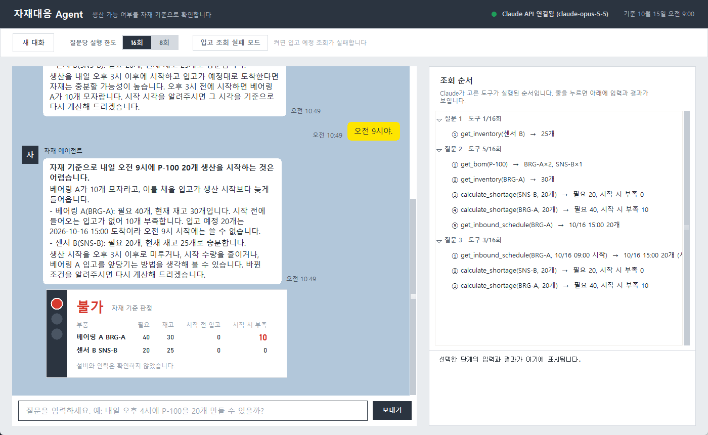
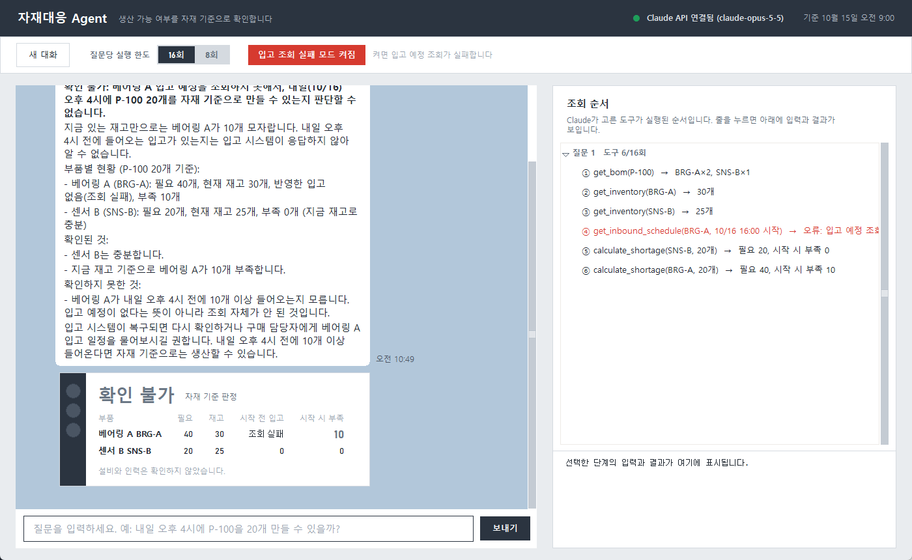

# 자재대응 Agent — 생산 가능 여부 확인

생산 담당자가 "내일 P-100을 20개 만들 수 있을까? 부족한 부품은 입고 예정까지 확인해줘"라고 물으면, Claude가 **필요한 자료를 스스로 골라 조회하고** 자재 기준으로 생산 가능 여부를 답하는 AI Agent입니다. (실습 2)

- Claude API **tool use**로 동작합니다. 조회 순서는 정해져 있지 않고, Claude가 질문을 보고 도구와 입력값을 고릅니다.
- 부족량은 반드시 계산 도구로 구합니다. 생산 시작 시각이 없어 입고 반영 여부를 판단할 수 없으면 사용자에게 묻습니다.
- 실행한 도구와 결과를 화면에 그대로 보여줍니다. 도구 실행은 질문 한 건당 최대 16회(앱에서 8회로 변경 가능)입니다.



## 설치

Python 3.12에서 확인했습니다.

```powershell
pip install -r requirements.txt
copy .env.example .env   # .env를 열어 ANTHROPIC_API_KEY=sk-ant-... 입력
```

API 키는 환경변수 `ANTHROPIC_API_KEY`를 먼저 보고, 없으면 프로젝트 폴더의 `.env`에서 읽습니다. `.env`는 git에 올라가지 않습니다.

## 실행

```powershell
python app.py
```

| 화면 | 설명 |
|---|---|
| 상단 헤더 | API 연결 상태, 모델(`claude-opus-5-5`), 기준시각 10월 15일 오전 9:00 ("내일"은 10/16) |
| 조작 줄 | **새 대화**(대화·조회 기록 초기화), **질문당 실행 한도** 16회/8회, **입고 조회 실패 모드**(켜면 입고 예정 조회가 실패 — 대화 5 시연용) |
| 대화 | 카카오톡처럼 내 메시지는 오른쪽 노란 말풍선, 에이전트는 왼쪽 흰 말풍선(둥근 모서리). 생산 가능 여부를 판단한 답변 아래에 **안돈 판정 카드** |
| 안돈 판정 카드 | 공장 라인 경고등처럼 위에서부터 빨강·주황·초록 중 한 칸만 켭니다. 불가=빨강, 조건부 가능(예정대로 입고되면)=주황, 가능=초록, 확인 불가=모두 꺼짐. 부품별 필요·재고·시작 전 입고·시작 시 부족 |
| 조회 순서 | 질문마다 "도구 k/N회"와 Claude가 실행한 도구를 ①②③ 순서로 표시(실행 즉시 추가). 실패한 단계는 빨간색. 줄을 누르면 아래에 입력과 결과 원문 |

화면 디자인은 frontend-design 스킬로 방향을 정했습니다: 생산 현장의 안돈 신호등을 유일한 강조 요소로 두고, 나머지는 강철색 헤더와 작업장 바닥색 배경으로 차분하게 했습니다. 수량과 판정에는 산업 표지판 계열 글꼴(Bahnschrift)을 씁니다.

판정 카드는 Claude의 답변 문장이 아니라 계산 도구 결과 수치로 정합니다. 시작 시각을 되묻는 답변처럼 판단이 끝나지 않은 경우에는 카드가 나오지 않습니다.



## 도구

| 도구 | 역할 |
|---|---|
| `get_bom(product_code)` | 제품 한 개에 필요한 부품과 수량. 등록되지 않은 제품은 `found: false` (소요량을 만들지 않음) |
| `get_inventory(part_code)` | 부품의 현재 재고. 부품코드(`SNS-B`)나 부품명(`센서 B`) 모두 가능 |
| `get_inbound_schedule(part_code, production_start)` | 입고 예정 시각·수량. 생산 시작 시각을 주면 기준시각 이후 ~ 시작 시각까지 도착하는 입고만 합산. 입고 예정이 없으면 빈 배열(정상), 조회 실패는 오류 |
| `calculate_shortage(part_code, production_qty, qty_per_unit, current_stock, inbound_before_start)` | 필요수량 = 생산수량 × 소요량, 현재부족량, 시작시각기준부족량. 수량이 양의 정수가 아니면 오류 |

자료는 `참고/` 폴더의 CSV(`제품별_소요부품.csv`, `현재재고.csv`, `입고예정.csv`)와 `실습설정.json`(기준시각, 실행 한도)을 읽습니다.

## 시연 순서

1. "센서 B 재고만 알려줘." → 재고 조회 1회로 25개
2. "내일 P-100을 20개 만들 수 있을까? 부족한 부품은 입고 예정까지 확인해줘." → 시작 시각을 물음
3. "오전 9시야." → **불가**: 베어링 A 10개 부족, 오후 3시 입고분은 9시 생산에 사용 불가
4. 새 대화 → "내일 오후 4시에 P-100을 20개 생산할 수 있어?" → **조건부 가능**(예정대로 입고되면)
5. 새 대화 → "내일 P-999를 10개 생산할 수 있어?" → 등록되지 않은 제품
6. 새 대화 → 입고 조회 실패 모드 켜기 → 4번 질문 → **확인 불가**(현재 재고 부족은 설명, 입고 반영은 확인 못 함)

## 검증

- 질문 모음 9개와 대화 시나리오 5개를 실제 API로 실행해 기대 결과와 대조했습니다: [docs/검증/시나리오_검증.md](docs/검증/시나리오_검증.md) — 13개 시나리오 모두 통과
- 다시 실행: `python scripts/run_scenarios.py` (실제 API 비용 발생), README 화면 다시 찍기: `python scripts/capture_screens.py`

## 테스트

```powershell
python -m pytest -q
```

API 없이 가짜 Claude 응답으로 도구, tool use 반복 처리(실행 한도·오류·되돌리기), 판정 카드, 앱 화면을 확인합니다.

## 구조

```
app.py                     tkinter 앱 (화면만 담당)
material_agent/
  data.py                  CSV 읽기, 시각 해석(+09:00)
  config.py                실습설정.json, API 키
  tools.py                 도구 4개 + Claude용 도구 정의(strict)
  prompts.py               시스템 프롬프트
  agent.py                 tool use 반복 처리 (질문당 실행 한도)
  verdict.py               판정 카드 계산
scripts/                   시나리오 실행, 화면 캡처
docs/superpowers/          설계 문서, 구현 계획
process.md                 커밋별 작업 이력
```

판단 범위는 자재뿐이며 설비 능력과 인력은 확인하지 않습니다. 모든 자료는 연습용 가상 데이터입니다.
